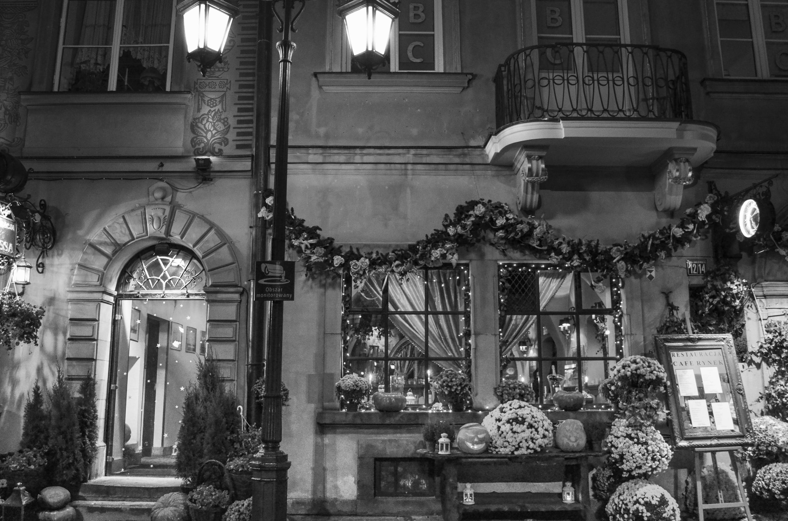
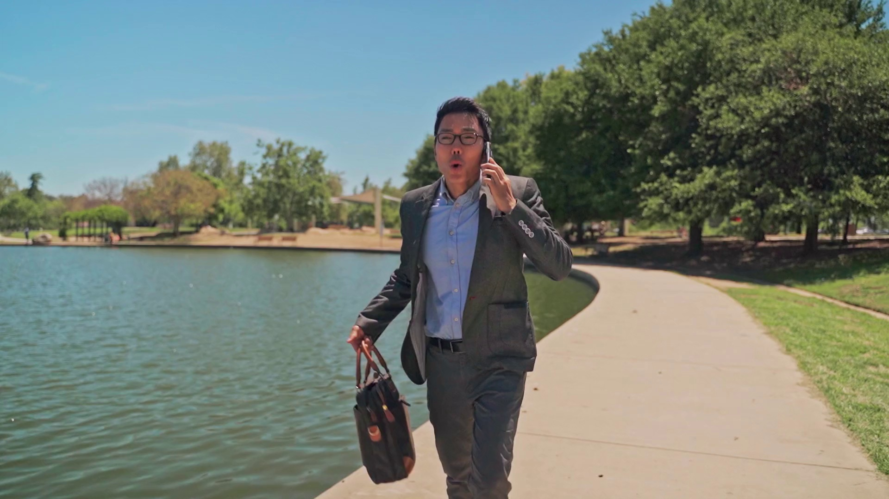
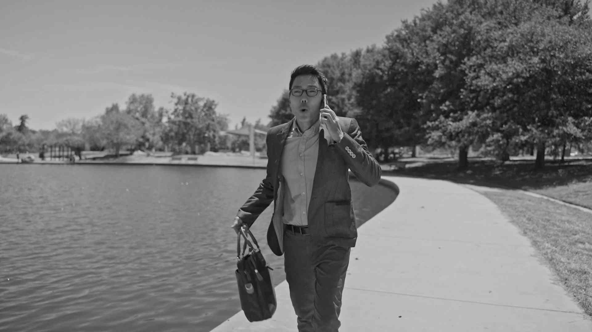

# PixelFold: Image and Video Compression

An educational implementation of transform-based image compression and a hybrid video codec using Python and Jupyter notebooks.

[Image Compression](Image_compression/Image_compression.ipynb) · [Video Compression](Video_compression/Vedio_compression.ipynb) · [Getting Started](#getting-started) · [License](LICENSE)

## Overview

PixelFold explores how images and video frames can be represented with fewer bits while preserving visual quality. The image pipeline combines block-based discrete cosine transforms (DCT), quantization, and Huffman coding. The video experiments extend this approach with motion estimation, residual coding, and an **IPPP group-of-pictures (GOP)** structure.

The repository includes executable notebooks, sample inputs, encoded coefficient streams, and reconstructed images and frames. Experiments examine the trade-off between compression ratio, bitrate, and peak signal-to-noise ratio (PSNR).

## Theoretical Background

### Image compression

The image notebook loads the sample in grayscale, resizes it to **3592 × 2376**, and divides it into **8 × 8 blocks**. Each block passes through the following stages:

1. **DCT:** Convert pixel values into frequency coefficients.
2. **Quantization:** Scale and round coefficients using a configurable quantization factor.
3. **Coefficient coding:** Apply differential pulse-code modulation (DPCM) to DC coefficients, and zigzag scanning followed by run-length coding to AC coefficients.
4. **Huffman coding:** Encode the coefficient streams using symbol-frequency codebooks.
5. **Reconstruction:** Reverse the coding stages, dequantize, and apply the inverse DCT.

Larger quantization factors generally reduce the encoded payload at the cost of reconstruction quality.

### Video compression

The video notebook uses intra-coded **I-frames** and predictive **P-frames**, repeating an **I → P → P → P** pattern. I-frames use the image compression pipeline. P-frames use block motion estimation and encode prediction residuals together with motion vectors. Decoding combines the reconstructed residuals with motion-compensated reference blocks.

Additional experiments choose quantization factors for a requested bitrate and adjust them using a target-PSNR feedback loop.

## Experiments Included

| Experiment | What it explores |
| --- | --- |
| Image quality presets | High, medium, and low quality through different quantization factors |
| Target image payload | Quantization adjustment for 612,000-bit and 500,000-bit targets |
| Hybrid video coding | IPPP coding with motion estimation and residual reconstruction |
| Rate control | Quantization selection for a requested bitrate |
| Quality control | Per-frame quantization adjustment toward a 40 dB PSNR target |

## Key Results

The following values are recorded in the saved output of the [image notebook](Image_compression/Image_compression.ipynb), using the included sample image. They are existing experiment results, not newly rerun benchmarks.

| Quality preset | Quantization factor | PSNR | Compression ratio |
| --- | ---: | ---: | ---: |
| High | 0.5 | 41.32 dB | 6.19:1 |
| Medium | 10 | 28.39 dB | 63.21:1 |
| Low | 20 | 24.45 dB | 131.67:1 |

**Metric interpretation:** The notebook computes compression ratio as raw grayscale image bits divided by the combined DC and AC Huffman payload bits. This excludes codebook and file-format overhead. The `.txt` artifacts store JSON containing bit strings and codebooks, so their actual disk sizes differ from the reported encoded payload sizes.

The saved quality-control experiment in the [video notebook](Video_compression/Vedio_compression.ipynb) reports **40.09–42.84 dB** across ten decoded frames for a **40 dB** target. These measurements describe the supplied sample and notebook implementation.

### 1. Image Reconstruction

<table>
  <tr>
    <th>Source image</th>
    <th>High quality · 41.32 dB</th>
  </tr>
  <tr>
    <td></td>
    <td></td>
  </tr>
  <tr>
    <th>Medium quality · 28.39 dB</th>
    <th>Low quality · 24.45 dB</th>
  </tr>
  <tr>
    <td></td>
    <td></td>
  </tr>
</table>

*Figure 1: Included source image and saved reconstructions at three quality levels. Compression is performed on the resized grayscale input.*

### 2. Video Reconstruction

<table>
  <tr>
    <th>Source frame 1</th>
    <th>Decoded frame 1 · target PSNR 40 dB</th>
  </tr>
  <tr>
    <td></td>
    <td></td>
  </tr>
  <tr>
    <th>Source frame 2</th>
    <th>Decoded frame 2 · target PSNR 40 dB</th>
  </tr>
  <tr>
    <td></td>
    <td></td>
  </tr>
</table>

*Figure 2: Source and reconstructed frames from the saved video quality-control experiment.*

## Getting Started

### 1. Environment Setup

Clone the repository and create a Python virtual environment:

```bash
git clone https://github.com/sandunikalakmali/pixelfold-image-video-codec.git
cd pixelfold-image-video-codec
python -m venv .venv
```

Activate it on **Windows PowerShell**:

```powershell
.\.venv\Scripts\Activate.ps1
```

Or on **Linux / macOS**:

```bash
source .venv/bin/activate
```

Install the notebook environment and the third-party libraries used by the code:

```bash
python -m pip install jupyterlab numpy opencv-python matplotlib
```

### 2. Image Compression

Start JupyterLab from the image directory so the notebook can resolve its relative input and output paths:

```bash
cd Image_compression
jupyter lab Image_compression.ipynb
```

Run cells in order, beginning with the imports and function definitions. The quality-preset experiment uses:

```python
Q_level = {"High": 0.5, "Medium": 10, "Low": 20}
```

Later sections adjust quantization for a target payload size. Reconstructed images and encoded DC/AC streams are written into the image directory; rerunning experiments can replace the included outputs.

### 3. Video Compression

From the repository root, launch the video notebook:

```bash
cd Video_compression
jupyter lab Vedio_compression.ipynb
```

The filename is `Vedio_compression.ipynb`, matching the file in this repository. Run the imports and helper definitions first, then follow the frame extraction, hybrid coding, rate-control, and quality-control sections in order. The repository already includes ten extracted sample frames.

Use `Q_factor` to explore fixed quantization and `target_psnr_value` to change the quality-control target. Fixed-quantization outputs are stored under `decoded_frames/`; quality-controlled outputs are stored under `decoded_frames_optimized/`.

## Repository Structure

```text
pixelfold-image-video-codec/
├── Image_compression/
│   ├── Image_compression.ipynb
│   ├── image1.jpg
│   ├── Image1_reconstructed_*.jpg
│   └── Image1_huffman_encoded_*_datastream_*.txt
├── Video_compression/
│   ├── Vedio_compression.ipynb
│   ├── video1(1080p).mp4
│   ├── frames/
│   ├── decoded_frames/
│   └── decoded_frames_optimized/
├── LICENSE
└── README.md
```

## License

This project is released under the [MIT License](LICENSE).

## Contact

For questions or feedback, [open an issue](https://github.com/sandunikalakmali/pixelfold-image-video-codec/issues) or visit [the maintainer's GitHub profile](https://github.com/sandunikalakmali).
